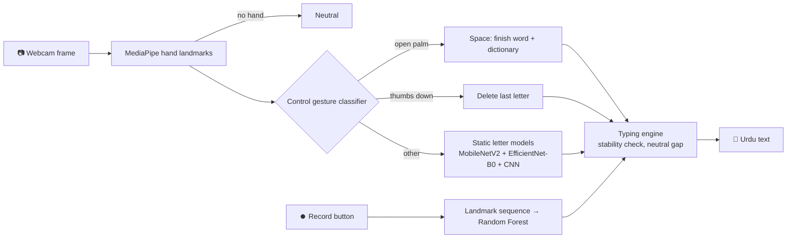
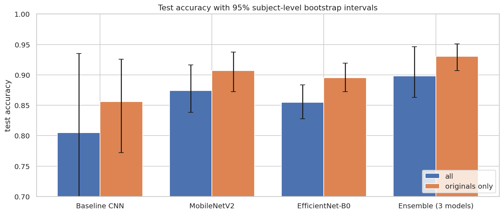

# 🤟 SignSense: Urdu Sign Language Recognition and Text Generation

Spell a word in **Urdu Sign Language**, letter by letter, in front of a webcam and watch it appear as **Urdu text**, like a keyboard that reads hands.

---

## 🎯 Problem statement

Sign language is the main way the deaf and hard-of-hearing community in Pakistan communicates, yet **Urdu Sign Language (USL) is understudied** compared with languages like ASL, and most existing work stops at recognising static alphabet images without producing readable text.

Most everyday words have their own sign, but **names and words without a dedicated sign are fingerspelled**, one letter after another. Letter-level recognition is therefore a necessary building block, and exactly what is needed for names and out-of-vocabulary words.

**SignSense** recognises the 40 Urdu letters (36 static hand shapes and 4 motion-based letters) and turns a sequence of signed letters into written Urdu words in real time.

## ✨ Features

- 🖐️ **36 static letters** recognised from a webcam image (3-model ensemble or a fast single model)
- 🌀 **4 dynamic letters** (آ ڑ ج ہ) recognised from a short recorded motion
- ✋ **Control gestures:** open palm = **space** (ends the word), thumbs down = **delete**
- 📖 **Dictionary correction** when a word ends (edit-distance based)
- 💡 **Top-3 suggestions** for the last letter, one click to replace it
- 📷 Works with the **webcam**, an **uploaded photo** or an **uploaded video**

## 🧭 How it works



1. **Hand landmarks** (MediaPipe) tell whether a hand is present and give 21 points.
2. A small **landmark classifier** recognises the space and delete gestures.
3. Otherwise the hand image goes to the **static letter models**.
4. **Dynamic letters** are recorded with a button and classified from the landmark sequence.
5. The **typing engine** commits a letter only after it was held steadily, requires a neutral gap before the same letter repeats, and corrects each finished word with the dictionary.

---

## 🗃️ Dataset

**Pakistan Sign Language Urdu Alphabets (UAlpha40)**, Bahria University, Karachi, on Mendeley Data · CC BY 4.0  
🔗 https://data.mendeley.com/datasets/3pvnnckxyb/1

| | |
|---|---|
| 💾 Size | about 5 GB (not stored in this repo; the notebooks download it into Colab) |
| 🖼️ Images | 22,865 JPG, 36 static letters |
| 🎞️ Videos | 393 MP4, 4 dynamic letters |
| 🏷️ Target | the letter class (40 classes), taken from the folder name |
| 🔎 Features | image pixels / video frames, plus derived subject id, original-or-augmented flag, size, brightness, contrast, blur, frame count, fps, hand landmarks |

Details of every data file: [`dataset/Readme.md`](dataset/Readme.md).

Additionally we recorded **1,634 landmark samples of the two control gestures** (space and delete) with 3 people (`dataset/control_gestures.csv`, landmarks only, no images).

---

## 🧹 Data Work

Notebooks: `setup_and_data_inventory` → `data_cleaning` → `eda` → `preprocessing`. All figures with explanations: [`images/Readme.md`](images/Readme.md).

### Cleaning (non-destructive; raw files never changed)

| Issue | Files | Action |
|---|---|---|
| Corrupt or zero-byte images/videos | 0 | none needed |
| Mixed-case extensions (`.JPG`/`.jpg`) | 1,678 | normalised in metadata |
| Exact duplicate images | 1,485 | removed (properly named copy kept) |
| 20 `Gaaf` images stored in the `Ghain` folder | 20 | mislabeled copies removed |
| `Gaaf` folder held a duplicated set (1,152 files) | 584 | reduced to 568 |
| Near-duplicates (same perceptual hash) | 6,674 | flagged, kept (augmented copies) |
| Size, brightness, blur outliers | 5,586 | flagged, kept (still valid signs) |

**Result:** 22,865 images → **21,360**; all **393 videos** kept.

### Key findings from the EDA

- ⚖️ Static classes are balanced (533-679 images each); dynamic classes are small (87-105 videos), about 6× fewer samples.
- 🧬 About **86% of the images are augmented copies**; only 2,897 originals from 84 people exist, so the split **must be by person** to avoid leakage.
- 📐 Resolutions range from about 200 to 2,400 px with mixed orientation, so images are padded to a square instead of stretched.
- 🌤️ The data is brighter than ImageNet, so dataset-specific normalization is used.
- 🎞️ Videos are all 30 fps and 13-118 frames long, so they are resampled to 88 frames.

### Preprocessing

224×224 padded images · subject-wise **70/15/15** split (59/13/12 people) · class weights · normalization from the training split · MediaPipe landmark sequences (88 × 21 × 3, wrist-centred and scaled) for the videos.

---

## 🤖 Models and Pipeline

Notebooks: `modeling_setup` → `static_models` → `static_evaluation` → `dynamic_models` → `pipeline` → `app_prep`.

### 🖐️ Static letters (36 classes)

Trained a small CNN from scratch, and fine-tuned MobileNetV2 and EfficientNet-B0 (ImageNet-pretrained). MobileNetV2 was tuned over 4 setups. The test set contains **people never seen in training**.

| Model | Val acc | Test acc | Test macro-F1 | Test acc (originals only) | Top-3 | CPU ms/frame |
|---|---|---|---|---|---|---|
| Baseline CNN | 92.8% | 80.5% | 0.802 | 85.6% | 93.7% | 99 |
| MobileNetV2 | 93.2% | 87.4% | 0.869 | 90.7% | 97.3% | 55 |
| EfficientNet-B0 | 90.9% | 85.5% | 0.853 | 89.5% | 97.7% | 68 |
| **Ensemble of 3** | n/a | **89.8%** | **0.897** | **93.0%** | 97.7% | 222 |



- Every model is worse on new people than on validation; the pretrained models generalise best.
- The models make different mistakes (31.5% of test images are wrong for at least one model, only 4.2% for all three), which is why the ensemble helps (329 errors vs about 408 for MobileNetV2).
- Hard letters for every model: Zay, Taay, Tay, Nuungh, Kiaf, Fay.

### 🌀 Dynamic letters (4 classes, 393 videos)

Compared Random Forest, MLP, 1D-CNN, LSTM and GRU on landmark sequences with 5-fold cross-validation (334 videos) and a final test on 59 held-out videos.

| Model | CV macro-F1 | Test accuracy (59 videos) |
|---|---|---|
| **Random Forest** (chosen) | **0.988 ± 0.006** | 100% |
| LSTM | 0.985 ± 0.030 | 98.3% |
| 1D-CNN | 0.981 ± 0.023 | 100% |
| GRU | 0.967 ± 0.031 | 96.6% |
| MLP | 0.963 ± 0.039 | 100% |

The top models are statistically tied. A simple Random Forest on summary statistics matches the LSTM, which suggests these four motions are easy to separate. See the limitations below.

### ✋ Control gestures and routing

- **Space / delete classifier** (gradient boosting on landmarks, 3 people): recall about **99%** (space) and **98.5%** (delete), false alarms about **0.2% per frame** on held-out people's letters and 0% on held-out video frames.
- **Automatic routing between static and dynamic letters failed:** a motion-based router found only 13 of 59 dynamic test videos, because wrist-normalized landmarks make the motion of dynamic letters as small as hand jitter. **Decision:** dynamic letters use a push-to-record button.

### 🧮 Full-pipeline simulation (word level)

Hundreds of words were typed through the whole pipeline using held-out test images and videos (ensemble, confidence 0.5, 3 stable frames):

| Words | Without dictionary | With dictionary | Character error rate |
|---|---|---|---|
| In the dictionary | 62.3% | **81.0%** | 7.0% |
| Not in the dictionary (like names) | 49.0% | 48.0% | 15.4% |

Dictionary correction fixes many single-letter errors in known words but cannot help names. One wrong letter spoils a whole word, so word accuracy is far below letter accuracy.

### 🔬 Improvement round (static letters)

To narrow the gap between validation and new people, three ideas were tested on the **validation split only**: a **landmark classifier** (hand shape without background or skin tone), an improved **CNN training recipe** (stronger augmentation, label smoothing, all layers fine-tuned with a cosine schedule), and a **fusion** of both with the earlier ensemble. The test set only reported the candidates; a gain counts as real only if the paired bootstrap interval excludes 0.

| Candidate | Val macro-F1 | Test acc | Test macro-F1 | Test acc (originals) | Gain vs v1 ensemble (95% CI) |
|---|---|---|---|---|---|
| v1 CNN ensemble (previous) | 0.951 | 89.8% | 0.897 | 93.0% | n/a |
| v2 CNN alone (MobileNetV2, v2b recipe) | 0.940 | 88.4% | 0.881 | 91.9% | -1.2 points (-5.5 to +3.1) |
| Landmark classifier alone (Random Forest) | 0.903 | 86.7% | 0.873 | 87.4% | -3.4 points (-12.3 to +2.7) |
| **Selected fusion:** v1 ensemble + v2 CNN + landmark (weights 0.1 / 0.2 / 0.7) | 0.960 | **93.1%** | **0.929** | **94.4%** | +3.1 points (-0.1 to +7.8) |

The fusion was selected for its best validation macro-F1 and is also best on every test metric, but its gain over the v1 ensemble is not statistically established (the interval just includes 0). Only two simpler fusions pass the rule: v1 ensemble + landmark (+2.9 points, +0.2 to +6.7) and v1 ensemble + v2 CNN (+1.5 points, +0.6 to +2.6). Most hard letters improved (Fay +0.15 F1, Taay +0.12), but Daal, Zuey and Zuad got worse (-0.09 to -0.14). The fusion costs about 55 ms more per frame than the v1 ensemble (estimate: one extra MobileNetV2).

---

## 🌐 Web app

Built with **Gradio**. Tabs: live webcam typing · letter from a photo · dynamic letter from a video · how to use.

```bash
cd app
pip install -r requirements.txt
python app.py        # then open http://127.0.0.1:7860
```

---

## ⚠️ Limitations

- 📉 About **87-90% of single static letters** are recognised for new people, so names (not in the dictionary) are often not typed perfectly; the suggestion buttons help.
- 🎞️ Videos carry no signer id, so the dynamic train/val/test split was random; the near-perfect dynamic results may be **optimistic for new signers** and the test set has only 59 videos.
- 🖐️ Control gestures were recorded by 3 people; a person outside the team has not yet been tested independently.
- 📖 The dictionary is a small demo list (about 170 words).
- 📷 Live accuracy depends on lighting, background and camera; the models were trained on dataset-style photos.
- 🔤 The class-to-Urdu-letter table follows the dataset's numbering and should be double-checked against the sign pictures.

## 🏁 Conclusion

SignSense shows that Urdu fingerspelling can be turned into text with a lightweight, CPU-friendly pipeline: pretrained image models for the 36 static letters, a landmark-based classifier for the 4 motion letters and the control gestures, and a typing engine that makes single-frame predictions usable as a keyboard. In practice the system types known words reliably and unknown names with occasional letter errors that the user can fix with the suggestion buttons. The main open problems are generalising to new signers and cameras, and automatic switching between static and dynamic letters.

---

## 📁 Repository structure

```
SignSense/
├── Readme.md
├── requirements.txt          
├── dataset/                 
├── notebooks/              
├── images/                 
├── models/                
├── scripts/            
└── app/                    
```

### 📓 Notebooks

| Phase | Notebook | Purpose |
|---|---|---|
| 1 | `setup_and_data_inventory` | download the dataset, inventory the files |
| 1 | `data_cleaning` | cleaning, duplicates, outliers → `clean_metadata.csv` |
| 1 | `eda` | exploratory analysis and figures |
| 1 | `preprocessing` | split, resize, normalization, landmark sequences |
| 2 | `modeling_setup` | training environment and data pipelines |
| 2 | `static_models` | train and tune the static letter models |
| 2 | `static_evaluation` | test evaluation, confusion matrix, error analysis |
| 2 | `dynamic_models` | dynamic letter models with cross-validation |
| 2 | `pipeline` | control gestures, router study, typing engine, simulation |
| 2 | `app_prep` | float32 export, CPU speed, app configuration |
| 2 | `static_improvement` | landmark classifier, improved CNN recipe, fusion of models, test evaluation of the candidates |

## 📚 Detailed documentation

Each main folder has its own readme with the details of its files and results.

| Folder | Readme | What you will find |
|---|---|---|
| `dataset/` | [dataset/Readme.md](dataset/Readme.md) | Source and license of the data, every data file and which notebook produced it, letter names with Urdu characters, train/validation/test splits |
| `images/` | [images/Readme.md](images/Readme.md) | All figures from the notebooks, each with a short note on what it shows |
| `models/` | [models/Readme.md](models/Readme.md) | The trained models, evaluation tables and configuration files, a results summary, and how to load or regenerate the models |
| `app/` | [app/Readme.md](app/Readme.md) | How to run the web app, its tabs and settings, the files in the app folder, how a frame is processed, and troubleshooting |

## ▶️ How to run

**Notebooks (Google Colab).** The data is large, so run the notebooks in Colab, in the order above, with *Runtime → Run all*. Phase 2 notebooks read and write a Google Drive folder `MyDrive/SignSense_data` that holds the Phase 1 outputs. `static_models` and `static_evaluation` need a **T4 GPU**; `dynamic_models` runs on either; `pipeline`, `app_prep` and the app run on CPU.

**Web app (local)**
```bash
cd app && pip install -r requirements.txt && python app.py
```
**Record control gestures** (needs a webcam): `python scripts/collect_gestures.py --person yourname`  

**Tech stack:** Python · TensorFlow/Keras · scikit-learn · MediaPipe · OpenCV · Gradio · pandas · matplotlib

## 🙏 Credits

- 🗃️ Dataset: *Pakistan Sign Language Urdu Alphabets*, Bahria University Karachi (Sajid, Javaid, Baloch), CC BY 4.0, https://data.mendeley.com/datasets/3pvnnckxyb/1
- 🧠 Pretrained backbones: MobileNetV2 and EfficientNet-B0 (ImageNet) via Keras Applications; hand landmarks: Google MediaPipe
- 📄 License: see [`LICENSE`](LICENSE)
