# Figures

Plots generated by the notebooks in `notebooks/`, with a short note on what each one tells us about the data.

## Data cleaning (`data_cleaning.ipynb`)

**01_image_outlier_boxplots.png**

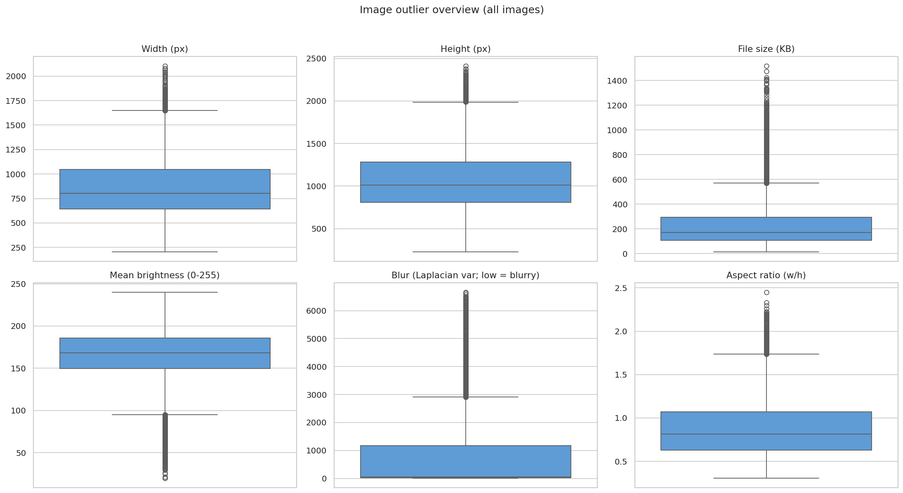

Boxplots of width, height, file size, brightness, blur and aspect ratio show a very wide spread in image size and sharpness.
These outliers were flagged but kept, since unusual images are still valid signs.

**02_darkest_images.png**

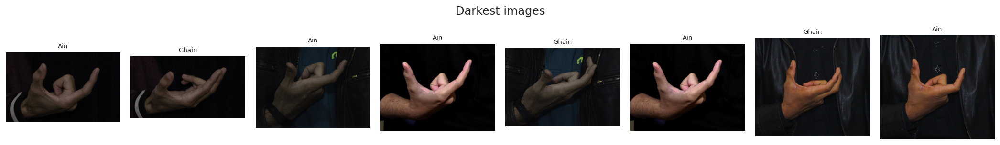

The eight darkest images in the dataset, checked by eye.
They are still clear hand signs, so dark images were kept rather than removed.

**03_blurriest_images.png**

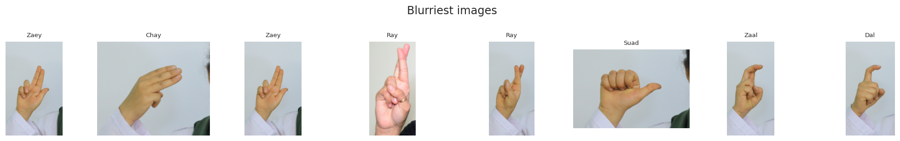

The eight blurriest images by Laplacian variance, checked by eye.
Low sharpness alone is not a reason to drop a sample, so they were kept.

**04_video_outliers.png**

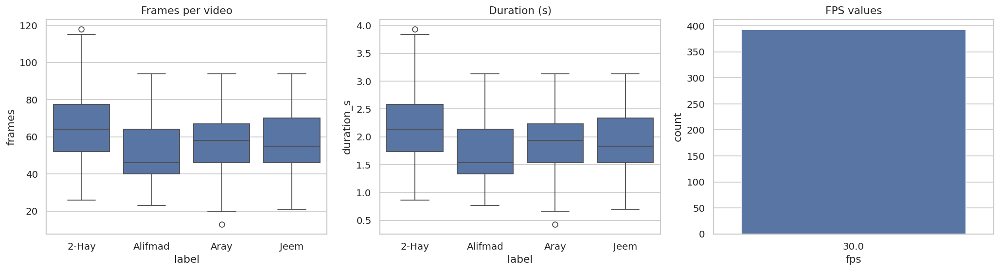

Frames per video, duration and fps for the four dynamic classes: all videos run at the same fps, but their lengths vary a lot.
This variation is why videos need to be resampled to a fixed length before the sequence model.

## Exploratory data analysis (`eda.ipynb`)

**05_class_distribution.png**

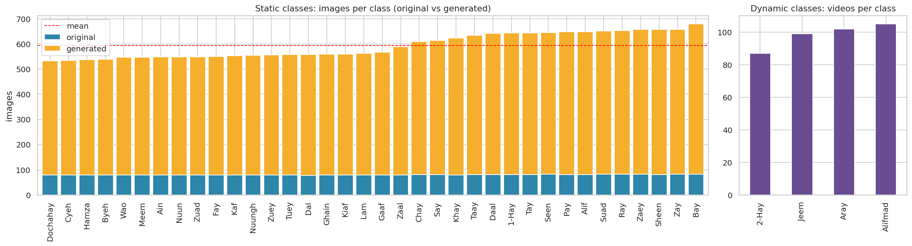

Images per static class (original vs generated) and videos per dynamic class, showing how balanced each group is.
The dynamic classes have far fewer samples than the static ones.

**06_subjects_and_originals.png**

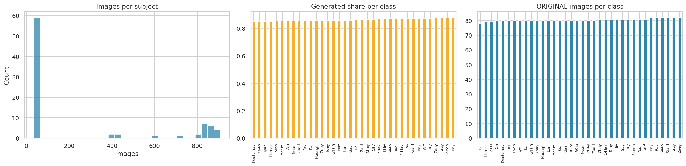

Images per subject, the share of generated images per class and the number of original images per class.
It shows how much of the data is augmentation, which is why the split has to be by subject.

**07_image_property_histograms.png**

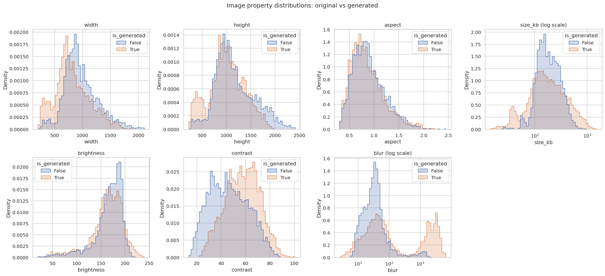

Distributions of resolution, aspect ratio, file size, brightness, contrast and blur, split into original and generated images.
Sizes and orientations vary widely, so every image must be resized to one fixed size.

**08_correlation_heatmap.png**

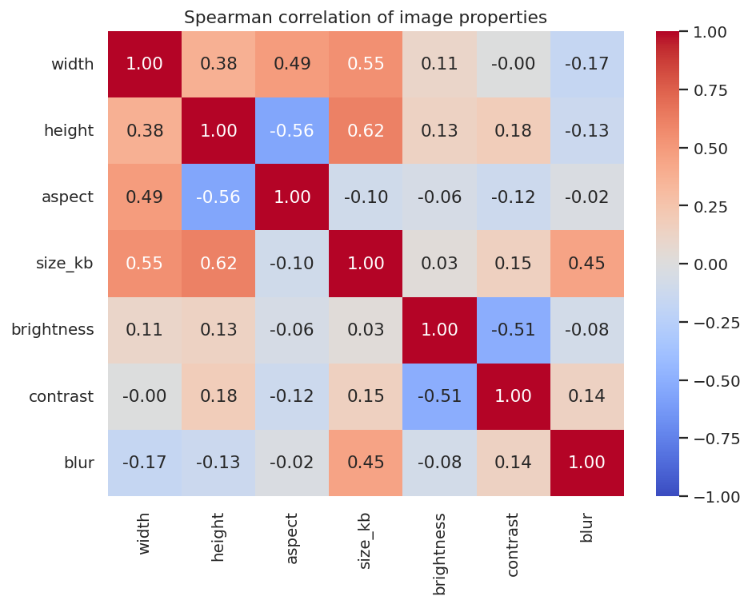

Spearman correlation between the numeric image properties.
Width, height and file size move together, so they carry largely the same information.

**09_properties_by_class.png**

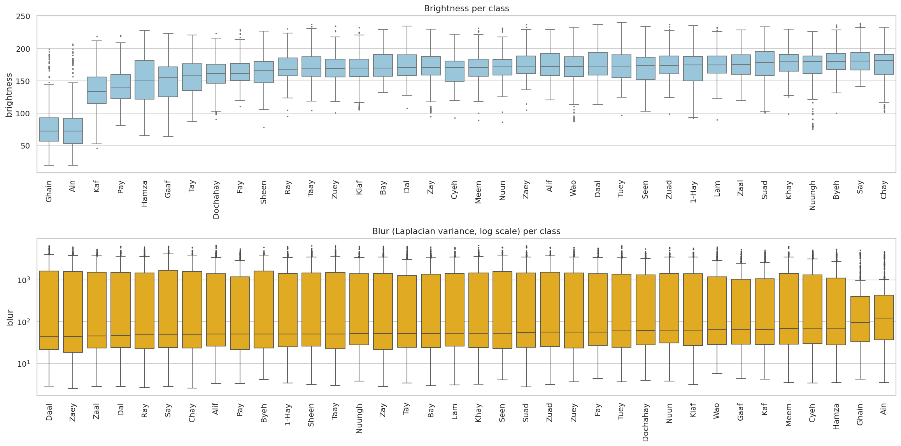

Brightness and blur per class, used to check whether the class can be guessed from imaging conditions alone.
Strong class differences here would signal a shortcut a model could learn instead of the hand shape.

**10_sample_per_class.png**

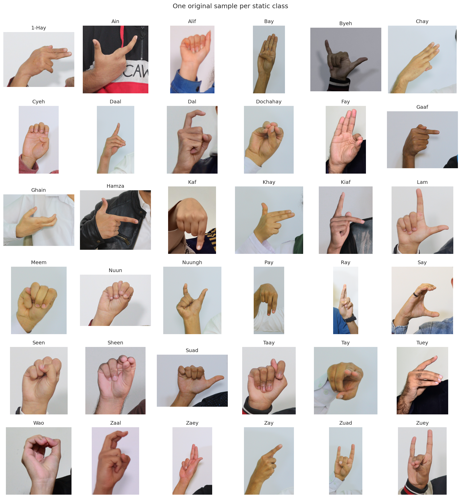

One original sample for each of the 36 static classes.
It shows the variety of hand shapes and backgrounds the classifier has to handle.

**11_mean_images.png**

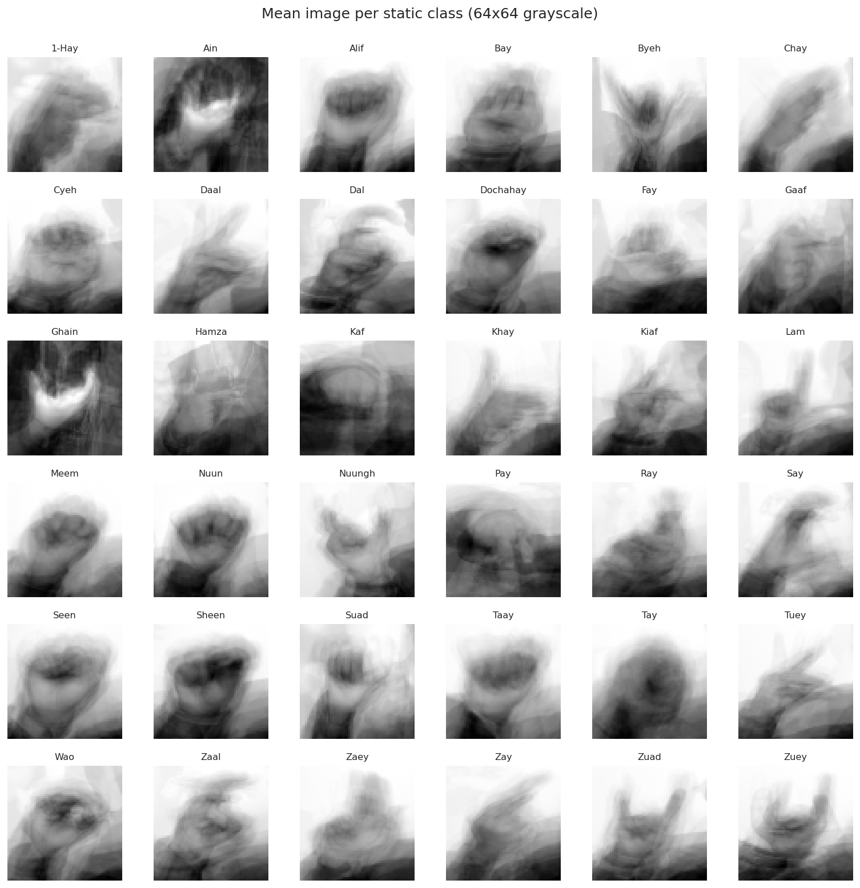

The average image of each static class at 64x64 grayscale.
Classes whose averages look alike are likely to be confused by the classifier.

**12_class_similarity.png**

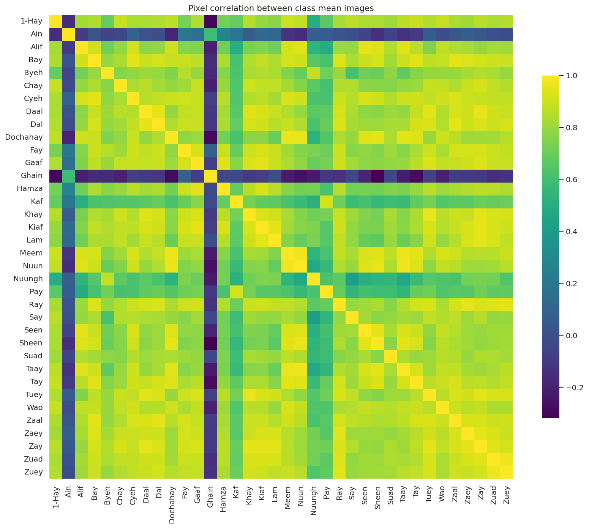

Pixel correlation between the class mean images, with the most similar pairs standing out as bright cells.
These pairs are the first place to look when reading the confusion matrix later.

**13_hand_detection_rate.png**

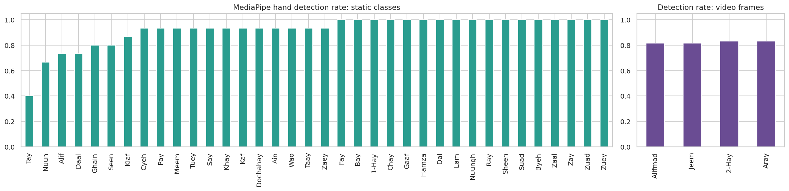

How often MediaPipe finds a hand, per static class and for the video frames.
Classes with a low rate cannot rely on hand landmarks and need the image-based CNN.

**14_video_stats.png**

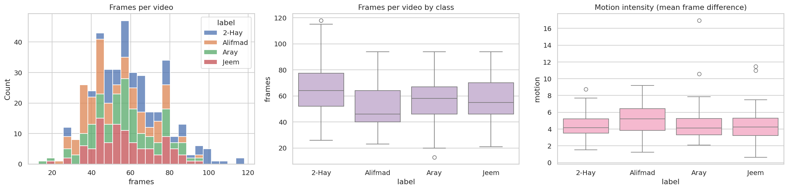

Frames per video and motion intensity for each dynamic class.
It guides the choice of a fixed sequence length and shows how different the four motions are.

**15_video_frame_strips.png**

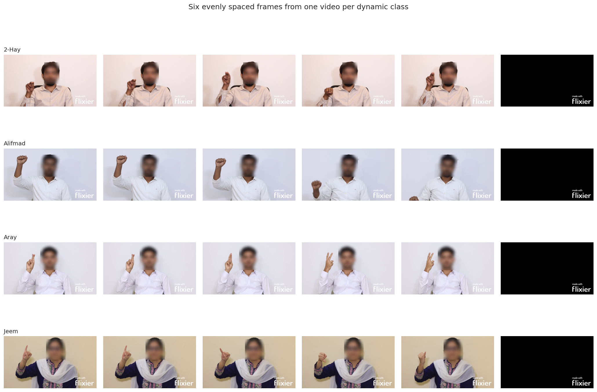

Six evenly spaced frames from one video of each dynamic class.
It shows how each motion unfolds over time.

## Preprocessing (`preprocessing.ipynb`)

**16_resize_policy_comparison.png**

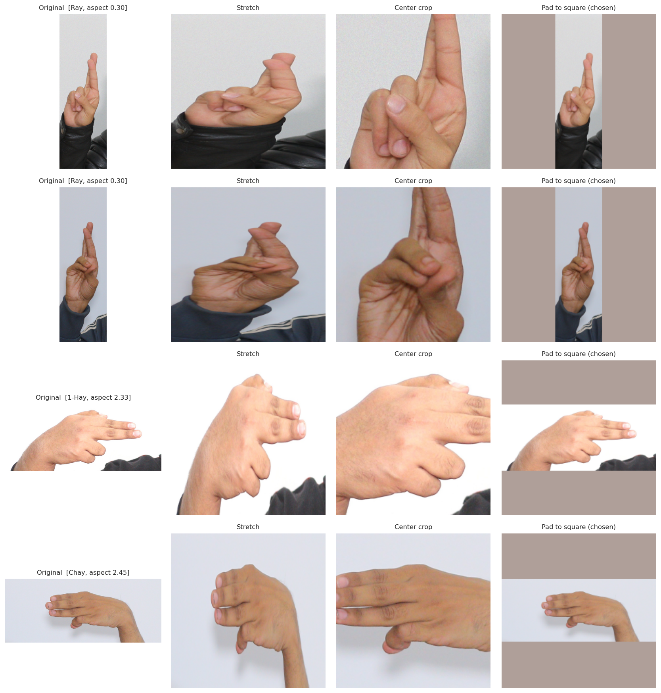

Stretch, center crop and pad-to-square compared on the most portrait and landscape images.
Padding keeps the whole hand undistorted, so it was chosen as the resize policy.

**17_split_distribution.png**

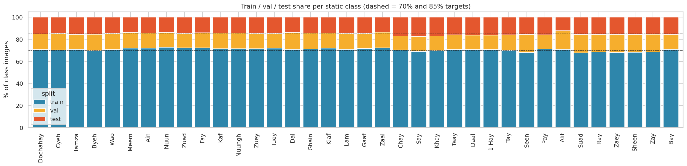

Train / validation / test share per class after the subject-wise split, against the 70% and 85% targets.
Every class stays close to the target proportions, with no person appearing in two splits.

**18_normalization_before_after.png**

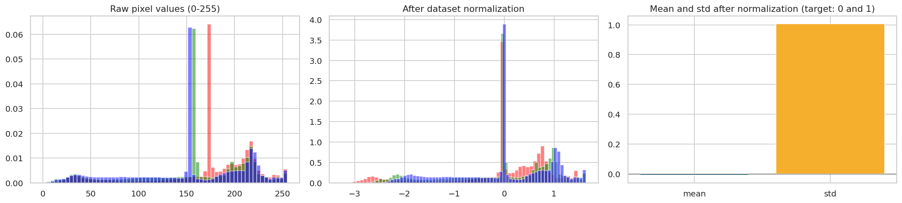

Pixel value histograms before and after normalization with the training-set mean and standard deviation.
After normalization the channels are centred near 0 with a spread near 1.

**19_landmark_sequences.png**

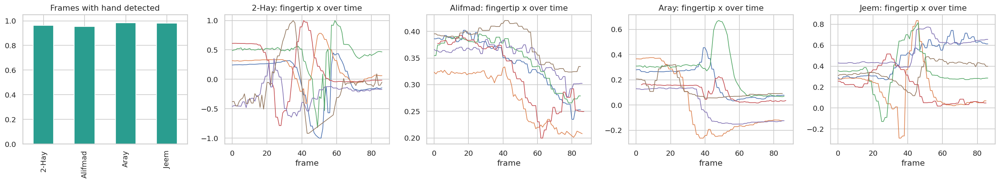

Hand detection rate per dynamic class and the normalized index-fingertip trajectories over time.
Visibly different curves per class show the landmark sequences carry enough signal for the LSTM.

## Static letter models (`modeling_setup.ipynb`, `static_models.ipynb`)
 
**p2_01_augmentation_check.png**

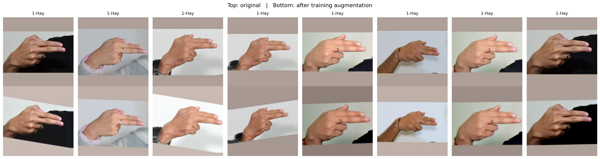

Original validation images (top) and their augmented versions (bottom): small rotation, shift, zoom, contrast and brightness changes.
No horizontal flips are used, since they would turn a right hand into a left hand.
 
**p2_02_static_training_curves.png**

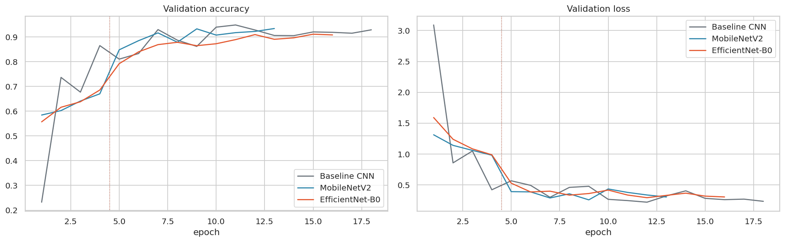

Validation accuracy and loss per epoch for the baseline CNN, MobileNetV2 and EfficientNet-B0 (dotted line = start of fine-tuning).
All models reach about 99.7% training accuracy but only about 91-93% validation accuracy, so they overfit to the training people.
 
**p2_03_static_model_comparison.png**

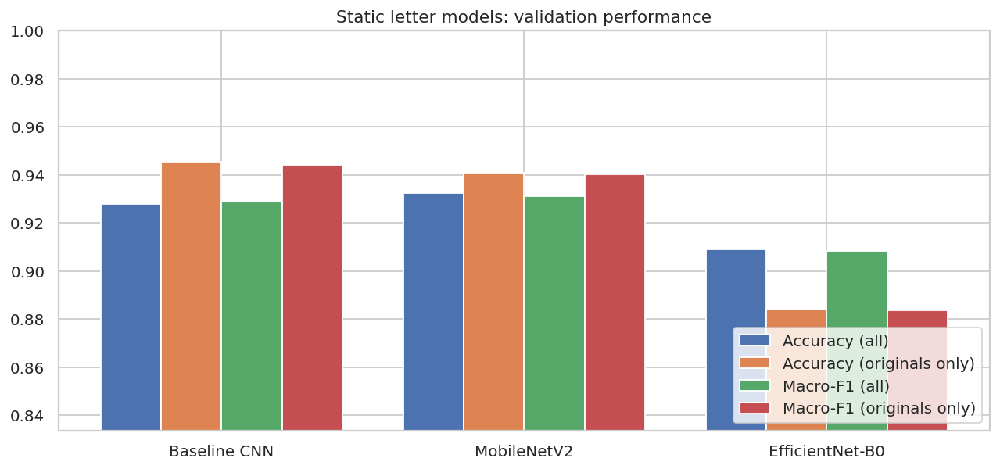

Validation accuracy and macro-F1 (all images and original images only) of the three static models.
MobileNetV2 (93.2%) and the baseline CNN (92.8%) are tied on validation; EfficientNet-B0 is lower (90.9%).
 
**p2_04_mobilenet_tuning.png**

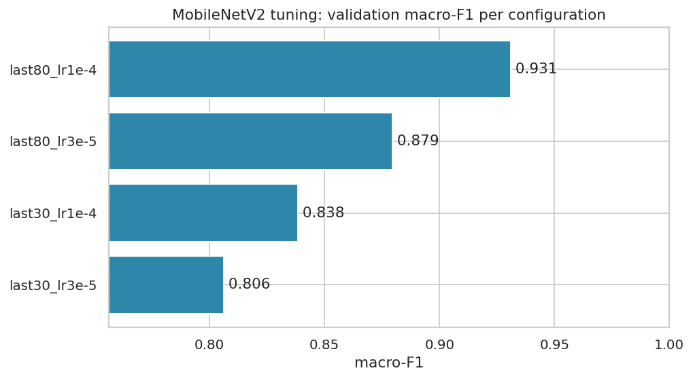

Validation macro-F1 of four MobileNetV2 fine-tuning setups (30 or 80 unfrozen layers, learning rate 1e-4 or 3e-5).
Unfreezing 80 layers at 1e-4 is clearly best (0.931); the best setup sits at the edge of the grid.
 
## Static model test evaluation (`static_evaluation.ipynb`)
 
**p2_05_static_test_comparison.png**

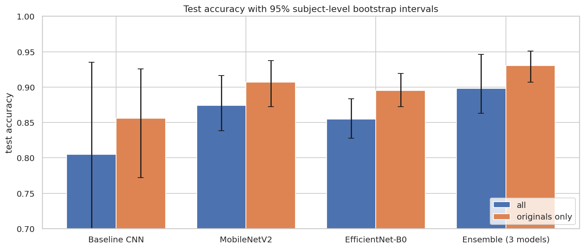

Test accuracy with 95% subject-level bootstrap intervals: baseline 80.5%, EfficientNet-B0 85.5%, MobileNetV2 87.4%, 3-model ensemble 89.8%.
Every model drops from validation to test; the pretrained models generalise to new people better than the baseline.
 
**p2_06_confusion_matrix.png**

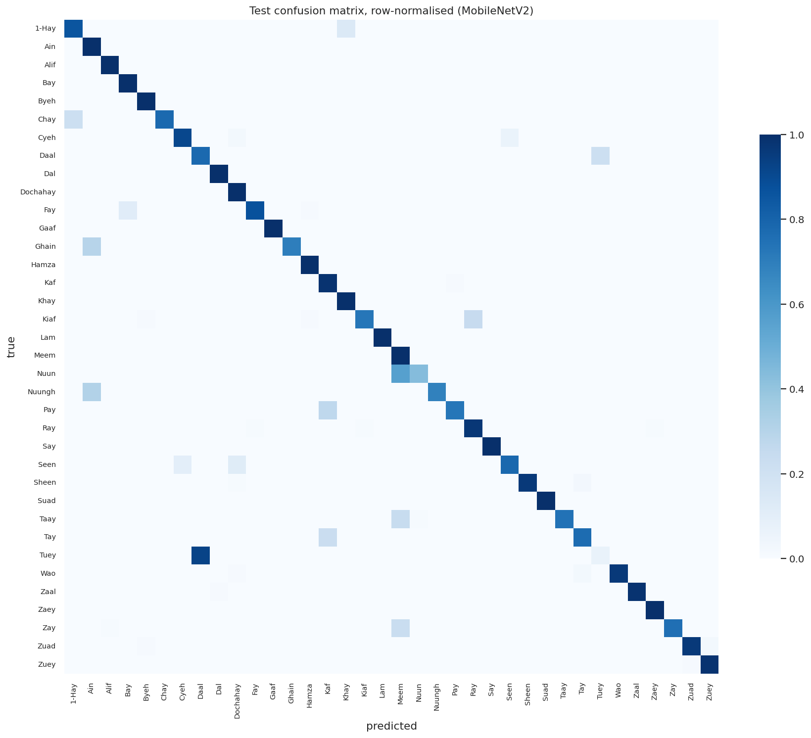

Row-normalised test confusion matrix of MobileNetV2 over the 36 static letters.
The strong diagonal shows most letters are recognised; off-diagonal cells mark the letters that get mixed up.
 
**p2_07_per_class_f1.png**

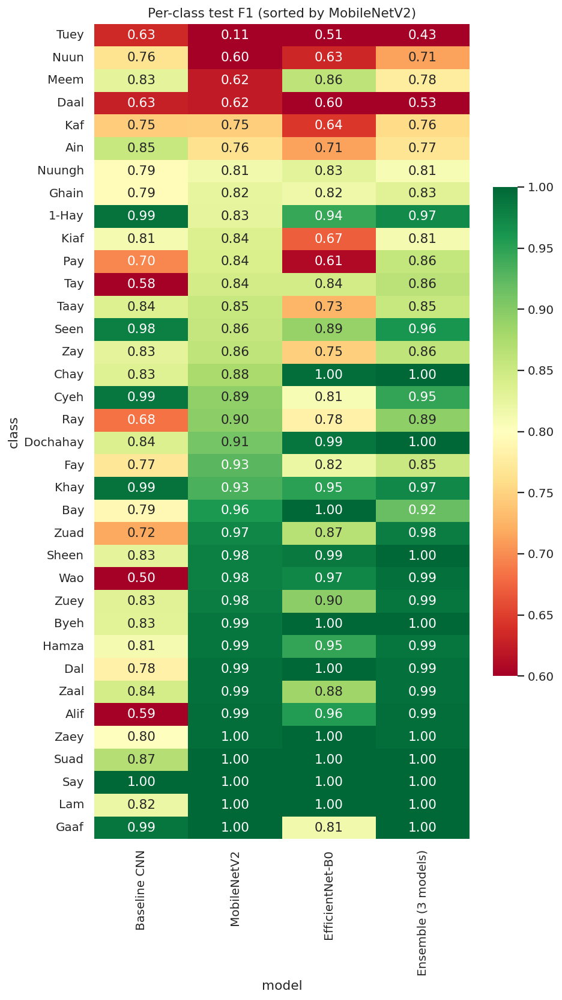

Per-letter test F1 for every model, sorted from weakest to strongest.
The images no model gets right are concentrated in Zay, Taay, Tay, Nuungh, Kiaf and Fay.
 
**p2_08_top_confusions.png**

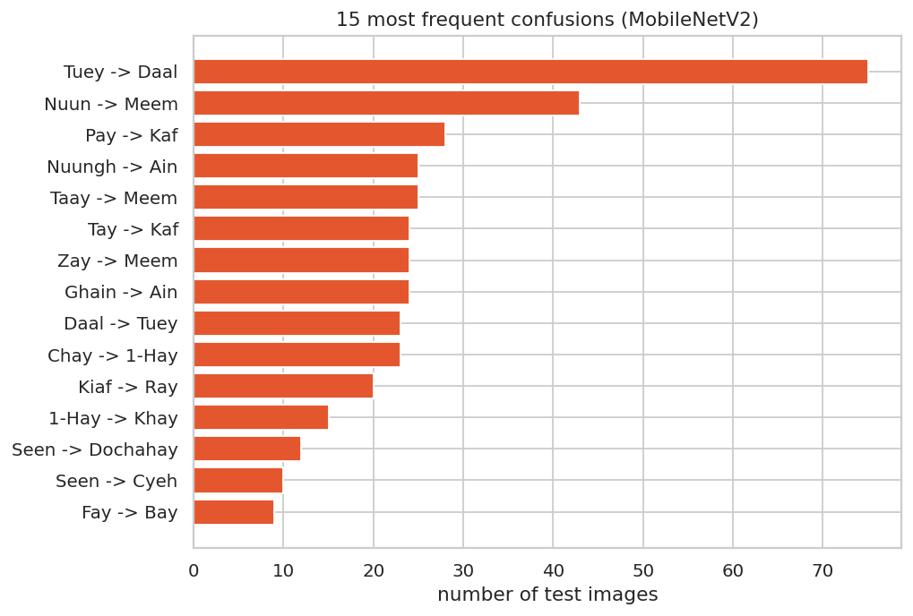

The 15 most frequent letter mix-ups of MobileNetV2 on the test set.
These are the visually similar signs that no amount of tuning is likely to separate completely.
 
**p2_09_error_examples.png**

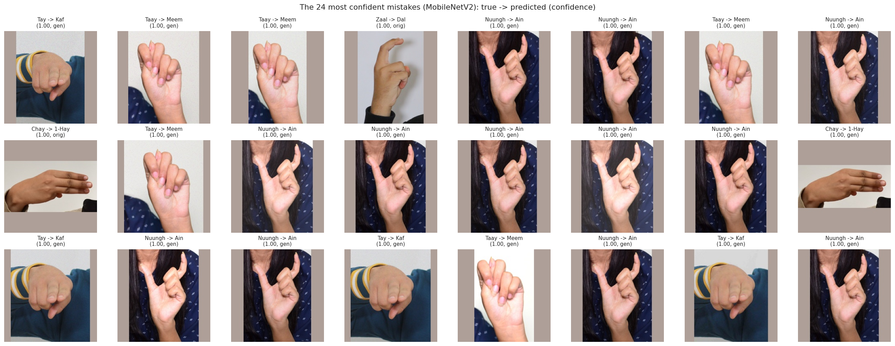

The 24 most confident mistakes of MobileNetV2 with true label, predicted label and confidence.
Looking at them separates real model errors from very similar signs and poor photos.
 
**p2_10_confidence_analysis.png**

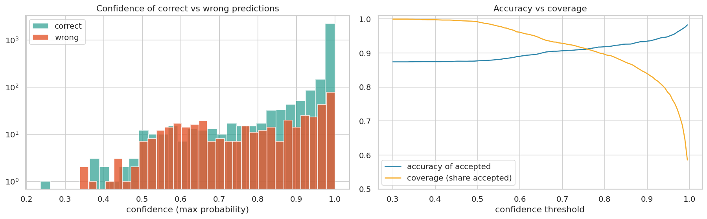

Confidence of correct versus wrong predictions, and accuracy against coverage as the confidence threshold rises.
It shows the trade-off behind the confidence setting used by the real-time pipeline.
 
**p2_11_error_by_factor.png**

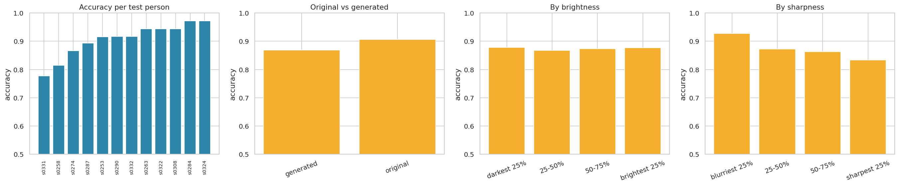

Test accuracy per person, original versus generated images, and by brightness and sharpness quartile.
It shows whether errors come from particular people or from image quality.
 
## Dynamic letter models (`dynamic_models.ipynb`)
 
**p2_12_dynamic_ablation.png**

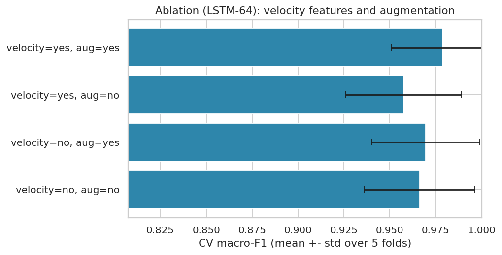

Cross-validated macro-F1 of the LSTM with and without velocity features and augmentation.
Velocity plus augmentation scored best (97.9%), but the gap is within the fold-to-fold spread.
 
**p2_13_dynamic_tuning.png**

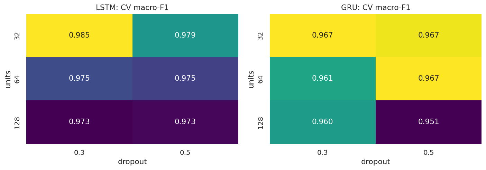

Cross-validated macro-F1 of LSTM and GRU for 32/64/128 units and dropout 0.3/0.5.
The smallest LSTM (32 units, dropout 0.3) is best at 0.985; larger models do not help with only 334 videos.
 
**p2_14_dynamic_cv_comparison.png**

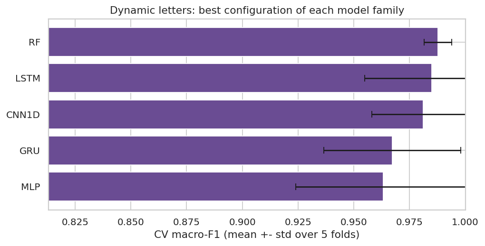

Best configuration of each model family under 5-fold cross-validation: Random Forest 0.988, LSTM 0.985, CNN1D 0.981, GRU 0.967, MLP 0.963.
All top models are within noise of each other; the Random Forest is the steadiest across folds.
 
**p2_15_dynamic_test_comparison.png**

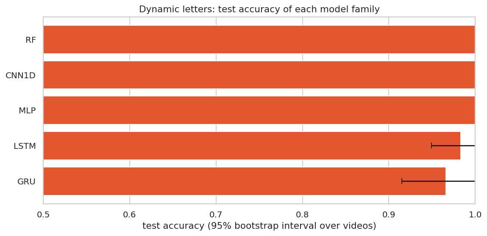

Test accuracy of each family on the 59 held-out videos with bootstrap intervals.
Random Forest, CNN1D and MLP get 59/59, LSTM 98.3%, GRU 96.6%; the test set is too small to rank them.
 
**p2_16_dynamic_confusion.png**

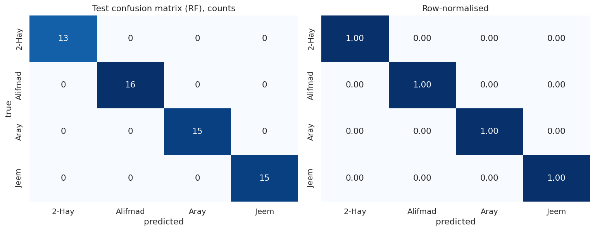

Test confusion matrix of the Random Forest over the four dynamic letters.
All 59 test videos are classified correctly.
 
**p2_17_dynamic_error_analysis.png**

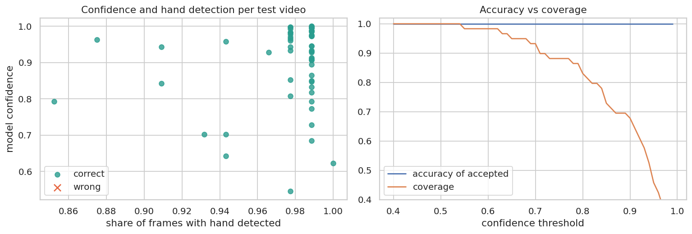

Confidence against the share of frames with a detected hand for every test video, and accuracy against coverage.
The hand was detected in about 98% of frames of correctly classified videos.
 
## Pipeline (`pipeline.ipynb`)
 
**p2_18_control_gestures.png**

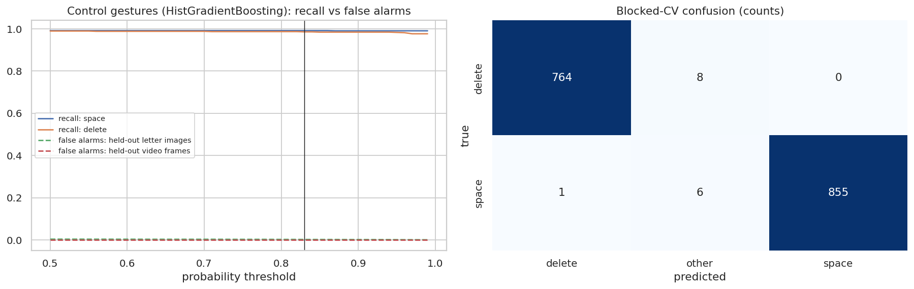

Recall of the space and delete gestures against false alarms on held-out people's letters and video frames, plus the blocked cross-validation confusion matrix.
At the chosen threshold of 0.83, recall is about 99% (space) and 98.5% (delete) with false alarms around 0.2% per frame.
 
**p2_19_router_calibration.png**

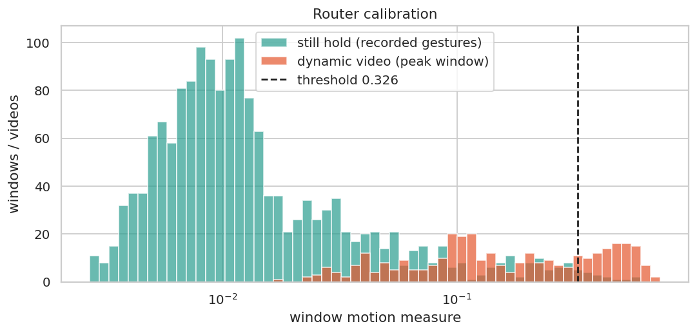

Motion of still holds against moving dynamic gestures, used to calibrate an automatic still/moving router.
The two ranges overlap, so the router failed (13 of 59 gestures found) and the app uses a push-to-record button instead.
 
**p2_20_pipeline_sweep.png**

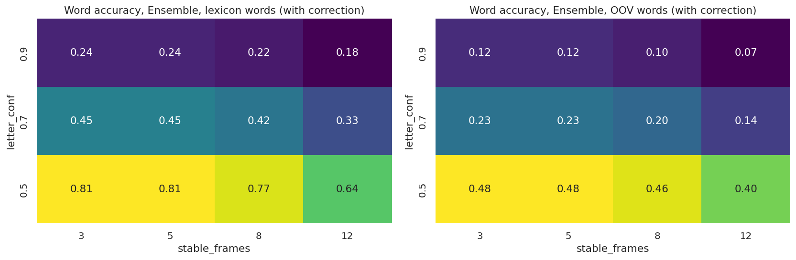

Simulated word accuracy of the whole pipeline for different confidence thresholds and stability settings (dictionary words and unknown words).
The 3-model ensemble with a low confidence threshold works best; 3 and 5 stable frames score the same in simulation.
 
**p2_21_dictionary_effect.png**

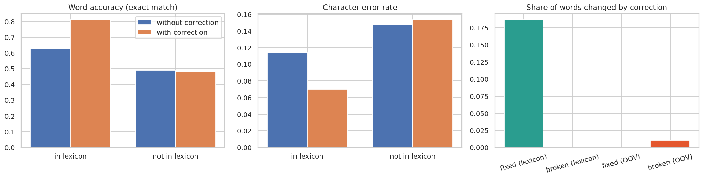

Word accuracy and character error rate with and without dictionary correction, and the share of words fixed or broken.
Correction lifts dictionary words from 62% to 81% but does not help unknown words such as names.

## Static improvement round (`static_improvement.ipynb`)

**p2_22_landmark_models.png**

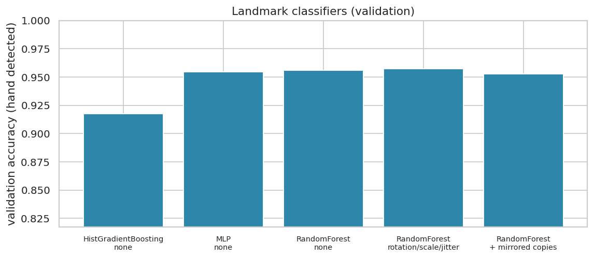

Validation accuracy of the hand-landmark classifiers (gradient boosting, MLP, random forest), without and with augmentation and mirrored copies.
It shows how well the hand shape alone, without background or skin tone, is recognised for new people.

**p2_23_cnn_recipe_v2.png**

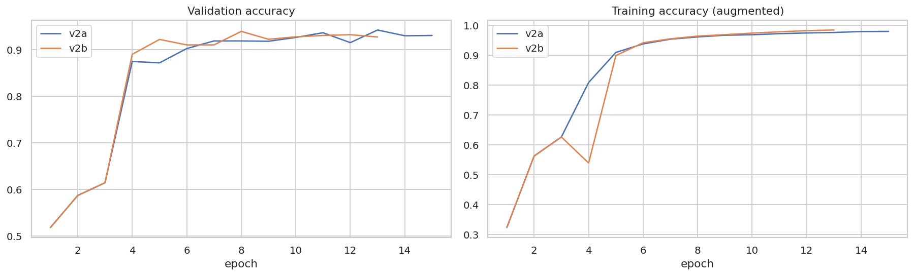

Validation and training accuracy per epoch of the two improved MobileNetV2 recipes (v2a, v2b) against the previous recipe (dashed line).
A smaller gap between the two curves means less overfitting to the training people.

**p2_24_fusion_weights.png**

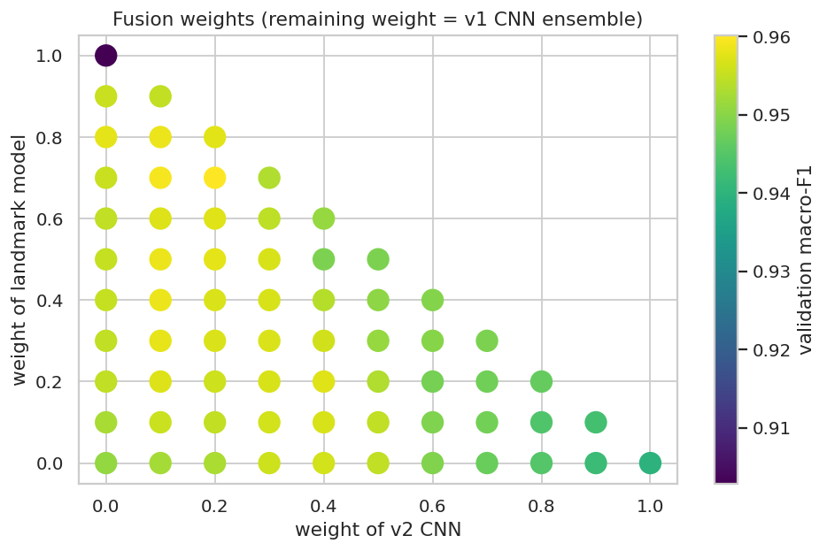

Validation macro-F1 for every combination of fusion weights between the v2 CNN, the landmark model and the v1 ensemble (the remaining weight).
A flat landscape means the result does not depend on the exact weights; a peak away from the corners means the models complement each other.

**p2_25_improvement_test.png**

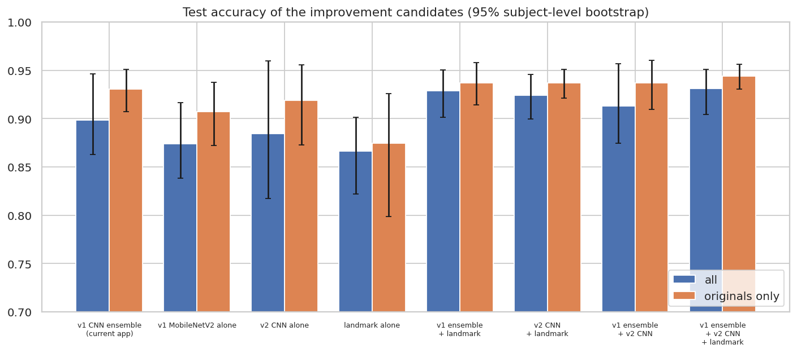

Test accuracy with 95% subject-level bootstrap intervals for every improvement candidate, on all images and on original images only.
A candidate counts as a real improvement only if its paired gain over the current model has an interval above zero (see `static_improvement_diffs.csv`).

**p2_26_per_class_gain.png**

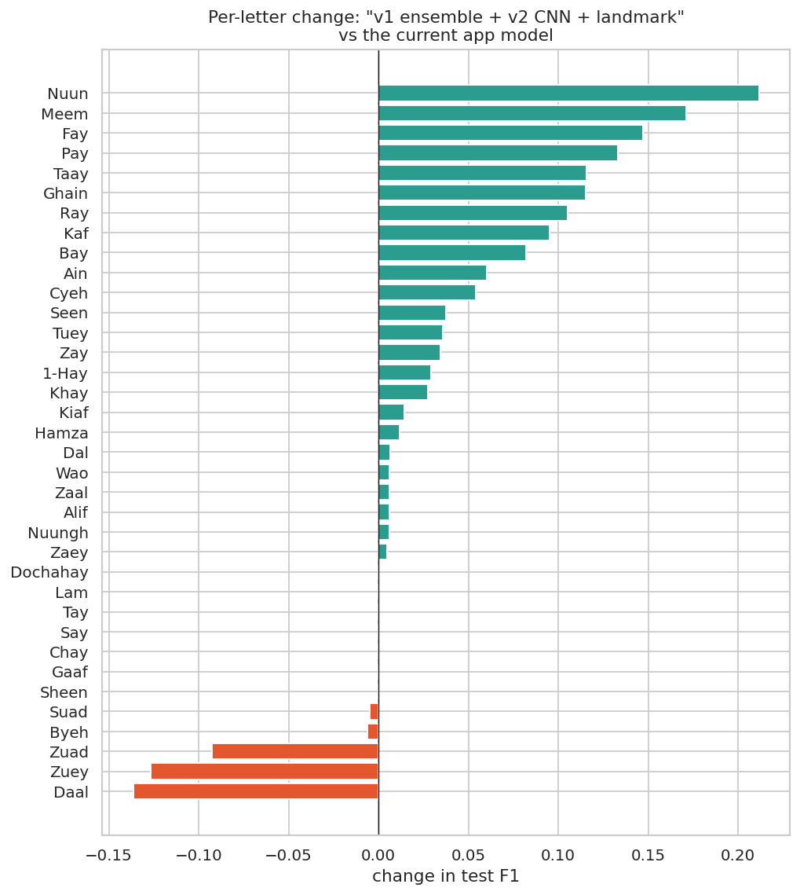

Change in test F1 per letter for the selected candidate compared with the current app model.
It shows whether the previously hard letters (Zay, Taay, Tay, Nuungh, Kiaf, Fay) improved.