# Figures

Plots generated by the notebooks in `notebooks/`, with a short note on what each one tells us about the data.

## Data cleaning (`data_cleaning.ipynb`)

**01_image_outlier_boxplots.png**
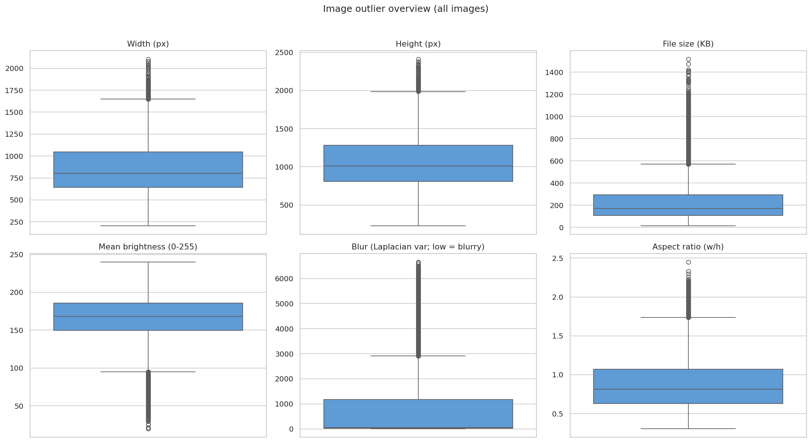
Boxplots of width, height, file size, brightness, blur and aspect ratio show a very wide spread in image size and sharpness.
These outliers were flagged but kept, since unusual images are still valid signs.

**02_darkest_images.png**
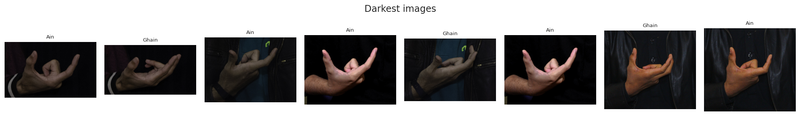
The eight darkest images in the dataset, checked by eye.
They are still clear hand signs, so dark images were kept rather than removed.

**03_blurriest_images.png**
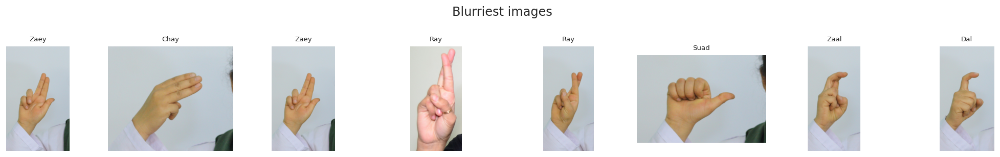
The eight blurriest images by Laplacian variance, checked by eye.
Low sharpness alone is not a reason to drop a sample, so they were kept.

**04_video_outliers.png**
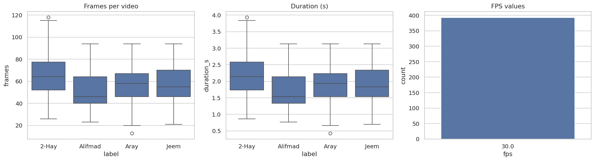
Frames per video, duration and fps for the four dynamic classes: all videos run at the same fps, but their lengths vary a lot.
This variation is why videos need to be resampled to a fixed length before the sequence model.

## Exploratory data analysis (`eda.ipynb`)

**05_class_distribution.png**
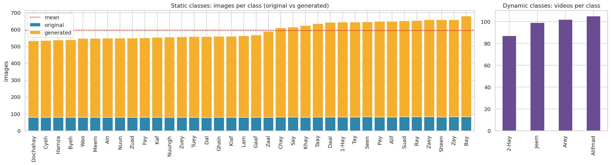
Images per static class (original vs generated) and videos per dynamic class, showing how balanced each group is.
The dynamic classes have far fewer samples than the static ones.

**06_subjects_and_originals.png**
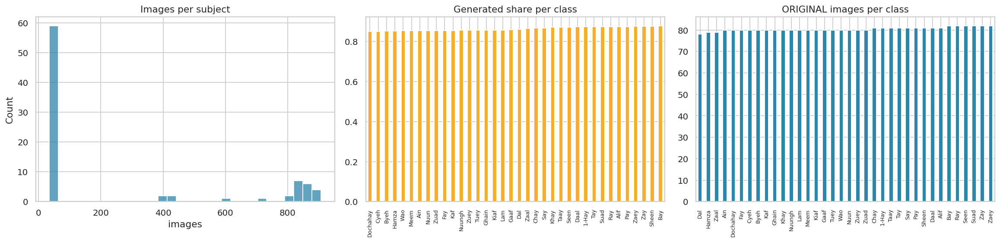
Images per subject, the share of generated images per class and the number of original images per class.
It shows how much of the data is augmentation, which is why the split has to be by subject.

**07_image_property_histograms.png**
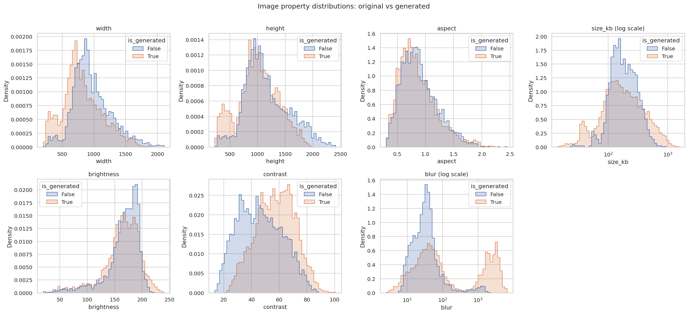
Distributions of resolution, aspect ratio, file size, brightness, contrast and blur, split into original and generated images.
Sizes and orientations vary widely, so every image must be resized to one fixed size.

**08_correlation_heatmap.png**
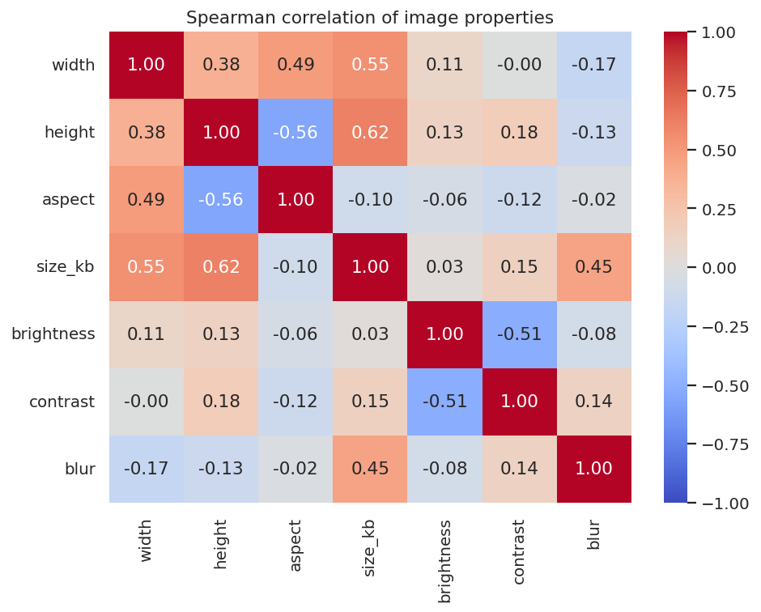
Spearman correlation between the numeric image properties.
Width, height and file size move together, so they carry largely the same information.

**09_properties_by_class.png**
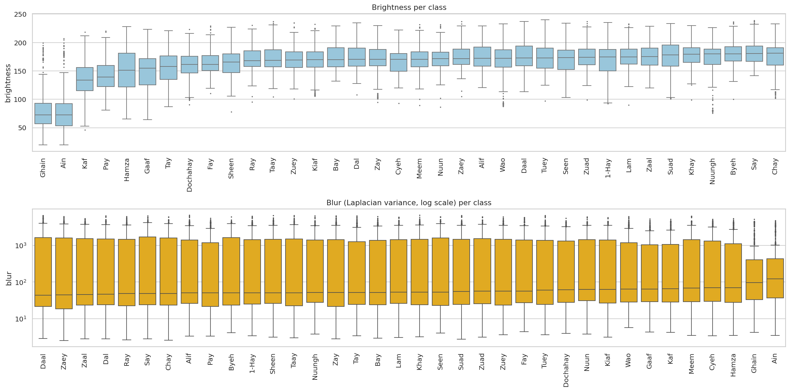
Brightness and blur per class, used to check whether the class can be guessed from imaging conditions alone.
Strong class differences here would signal a shortcut a model could learn instead of the hand shape.

**10_sample_per_class.png**
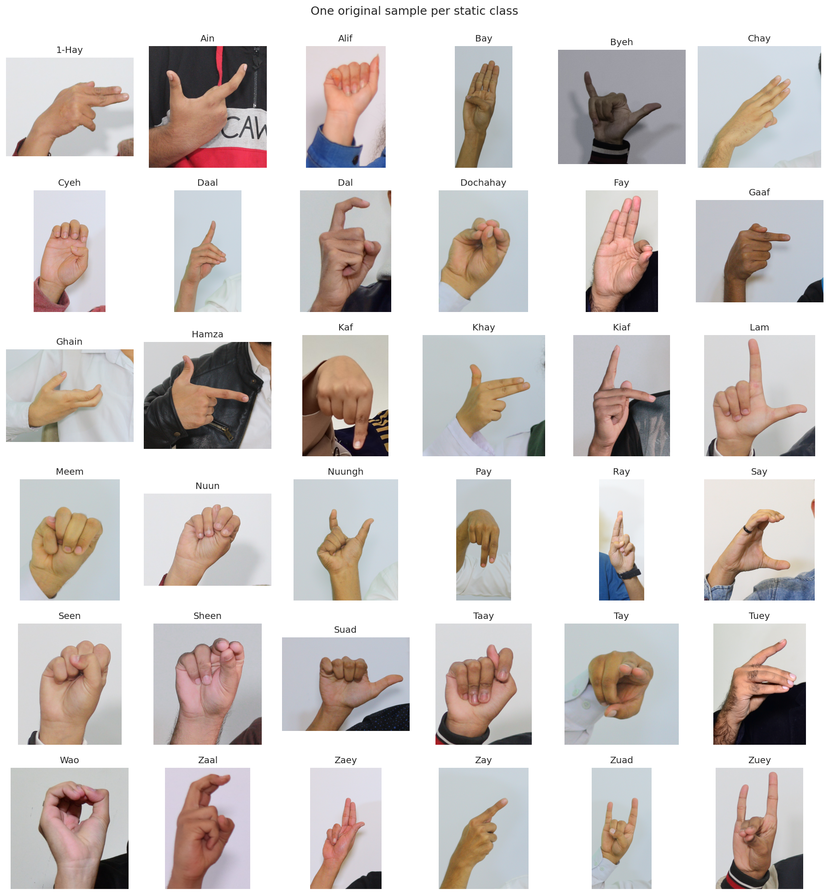
One original sample for each of the 36 static classes.
It shows the variety of hand shapes and backgrounds the classifier has to handle.

**11_mean_images.png**
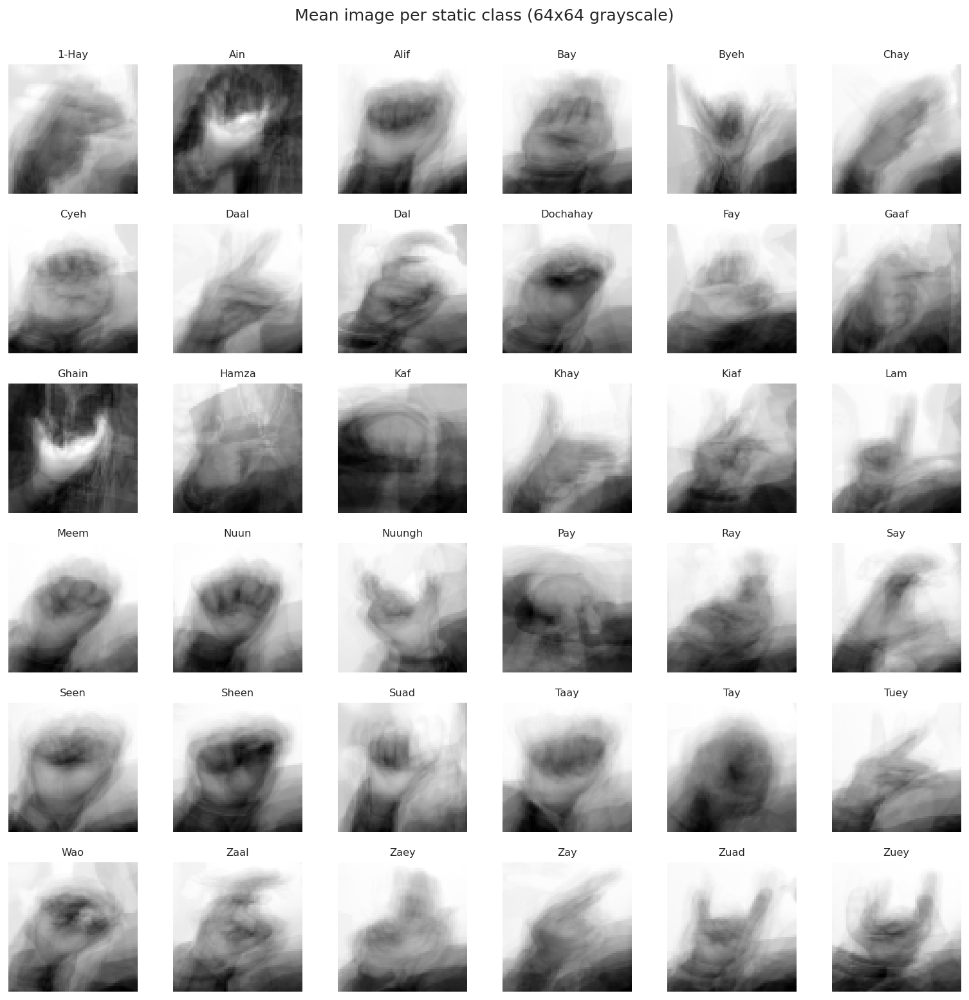
The average image of each static class at 64x64 grayscale.
Classes whose averages look alike are likely to be confused by the classifier.

**12_class_similarity.png**
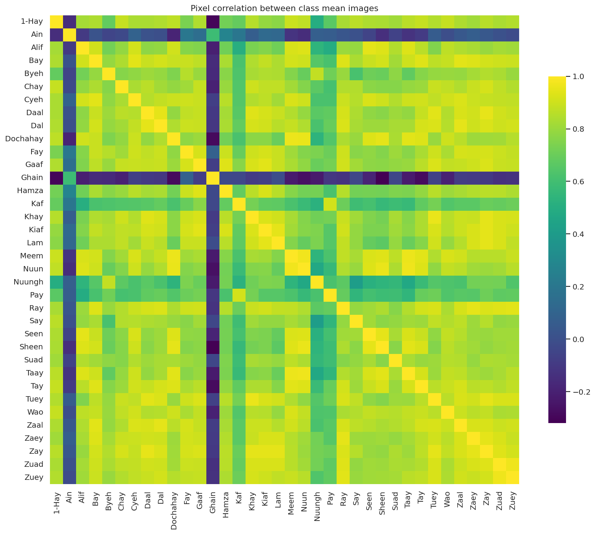
Pixel correlation between the class mean images, with the most similar pairs standing out as bright cells.
These pairs are the first place to look when reading the confusion matrix later.

**13_hand_detection_rate.png**
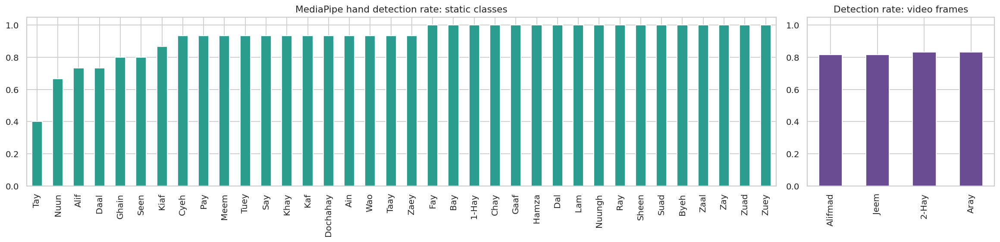
How often MediaPipe finds a hand, per static class and for the video frames.
Classes with a low rate cannot rely on hand landmarks and need the image-based CNN.

**14_video_stats.png**
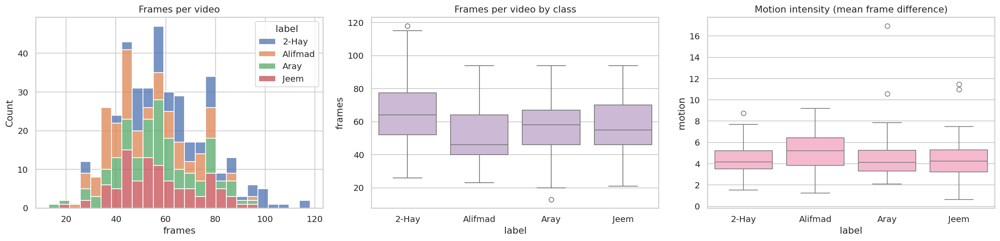
Frames per video and motion intensity for each dynamic class.
It guides the choice of a fixed sequence length and shows how different the four motions are.

**15_video_frame_strips.png**
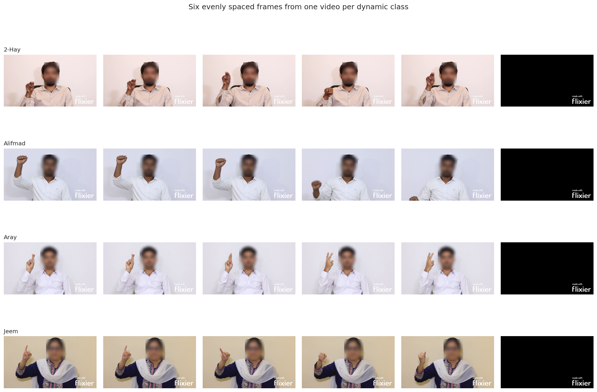
Six evenly spaced frames from one video of each dynamic class.
It shows how each motion unfolds over time.

## Preprocessing (`preprocessing.ipynb`)

**16_resize_policy_comparison.png**
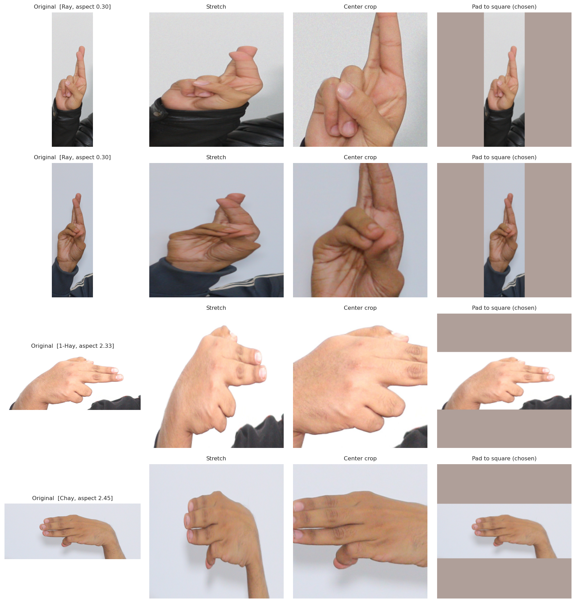
Stretch, center crop and pad-to-square compared on the most portrait and landscape images.
Padding keeps the whole hand undistorted, so it was chosen as the resize policy.

**17_split_distribution.png**
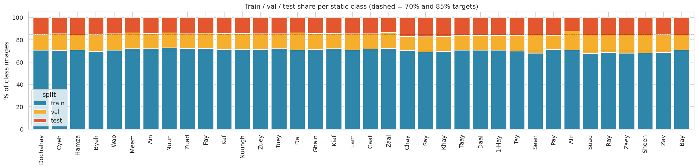
Train / validation / test share per class after the subject-wise split, against the 70% and 85% targets.
Every class stays close to the target proportions, with no person appearing in two splits.

**18_normalization_before_after.png**
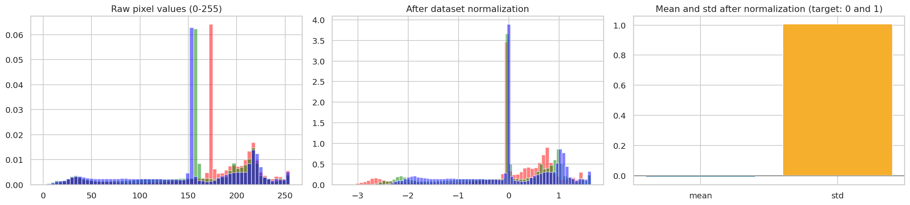
Pixel value histograms before and after normalization with the training-set mean and standard deviation.
After normalization the channels are centred near 0 with a spread near 1.

**19_landmark_sequences.png**
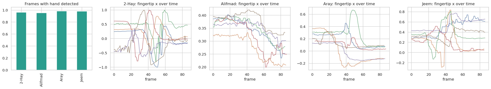
Hand detection rate per dynamic class and the normalized index-fingertip trajectories over time.
Visibly different curves per class show the landmark sequences carry enough signal for the LSTM.